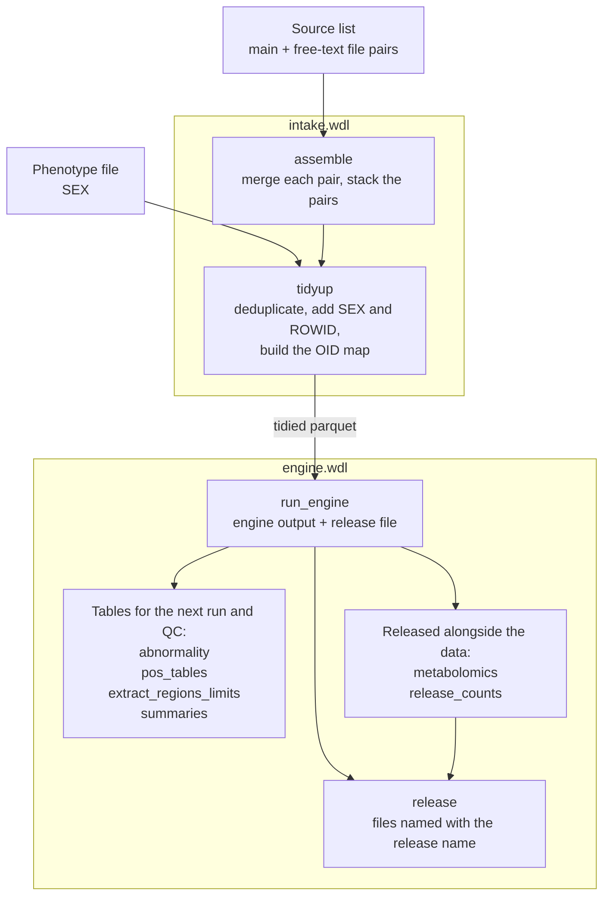
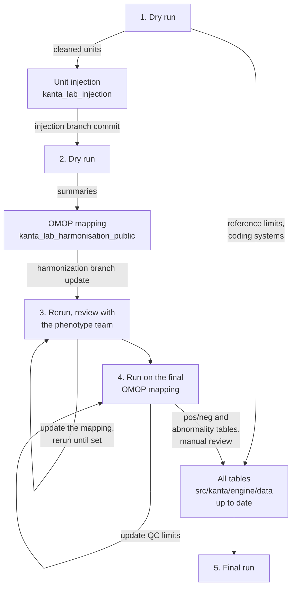

# KANTA LAB values preprocessing & QC

Based on Kira Detrois' [existing repo](https://github.com/detroiki/kanta_lab).

## Requirements

- Python >= 3.12
- `pandas >= 3.0.2`, `polars >= 1.40.0`, `pyarrow >= 24.0.0`

Dependencies are declared in `pyproject.toml` and pinned in `uv.lock`, managed with [uv](https://docs.astral.sh/uv/).

Run the pipeline and the scripts through `uv run`. The simplest way, from inside the repo (the first run builds a
`.venv/` in the repo):

```bash
uv run python -m kanta.engine --input-file <intake output>.parquet
```

To keep the venv outside the repo and run from any folder (adjust the paths):

```bash
UV_PROJECT_ENVIRONMENT=$HOME/.venvs/kanta uv run --locked --project $HOME/Projects/kanta_lab_preprocessing python -m kanta.engine --input-file <intake output>.parquet
```

Shortcut, in `~/.bashrc`:

```bash
alias kpy='UV_PROJECT_ENVIRONMENT=$HOME/.venvs/kanta uv run --locked --project $HOME/Projects/kanta_lab_preprocessing python'
```
This alias can also be used for the other helper scripts that live inside the repository.
```bash
kpy -m kanta.intake ...
kpy -m kanta.engine ...
kpy scripts/<folder>/<script>.py ...
```

## OUTPUT FILE

The pipeline produces one main file, the engine output (`<prefix>.parquet`; in the WDL `<release_name>.parquet`, e.g.
`kanta_R15_dev_2026_11_05.parquet`). The release file (`<release_name>_RELEASE.parquet`) is a curated subset of
its columns, renamed and typed for external use: in the release, the engine's literal `NA` strings become real
nulls (except for `TEST_NAME`, where an unmapped name is itself informative), and flags become booleans/integers.

N.B. The raw data contains a free-text column (`MEASUREMENT_FREE_TEXT`) that cannot be released, as it may contain
sensitive data. It holds a mix of numeric values, positive/negative results, results against thresholds (e.g.
`<3 ml`) and general notes. Instead of releasing it, the engine extracts from it what can be used, through cleaning
and whitelisting: values (`IS_VALUE_EXTRACTED`), units, outcome texts and positive/negative status.

Columns in engine-output order. **Release name** = the column's name in the release file; `NA` = not in the release.

| Column (engine output) | Release name | Easy Description | Technical Notes |
|---|---|---|---|
| `ROWID` | `ROWID` | Row ID, unique per row | Assigned by the intake after deduplication. Lets you compare rows across the pipeline's outputs (errors, abbreviation and unit changes). Only valid within one intake run. |
| `FINNGENID` | `FINNGENID` | Pseudonymised individual ID | |
| `SEX` | `SEX` | Sex of the individual | Joined from the phenotype file in the intake. |
| `EVENT_AGE` | `EVENT_AGE` | Age at the time of the event | |
| `APPROX_EVENT_DATETIME` | `APPROX_EVENT_DATETIME` | Approximate date and time of the event (± two weeks) | Built from `APPROX_EVENT_DAY` and `TIME`; rows whose date can't be parsed are dropped (logged in `_errors.parquet`, `DATE`). Typed as a UTC timestamp in the release. |
| `TEST_ID` | `TEST_ID` | National (THL) or local lab ID of the test | The national ID (`laboratoriotutkimusnimike`) when present, else the local code. |
| `TEST_ID_IS_NATIONAL` | `TEST_ID_IS_NATIONAL` | Whether `TEST_ID` is national | `1` national (THL), `0` local. Boolean in the release. |
| `TEST_NAME_ABBREVIATION` | `TEST_NAME` | Name of the test | The local name, or for national IDs the THL abbreviation from [`thl_lab_id_abbrv_map.txt`](/src/kanta/engine/data/thl_lab_id_abbrv_map.txt) (from [Kuntaliitto - Laboratoriotutkimusnimikkeistö](https://koodistopalvelu.kanta.fi/codeserver/pages/classification-view-page.xhtml?classificationKey=88&versionKey=120)). Stray characters and dashes are cleaned (`ABBREVIATION_*` in the config); changes are logged in `_abbr.parquet`. |
| `MEASUREMENT_VALUE` | `MEASUREMENT_VALUE_CLEANED` | Numeric value, on the scale the lab reported | Filled from the free text when the value column is empty (`IS_VALUE_EXTRACTED`). Not harmonized. |
| `MEASUREMENT_UNIT` | `MEASUREMENT_UNIT_CLEANED` | Unit, cleaned and completed | Cleaned (dictionary + regex), taken from the free text when missing, then completed by unit injection (see [Unit injection](#unit-injection)). Changes are logged in `_unit.parquet`. |
| `IS_VALUE_EXTRACTED` | `IS_VALUE_EXTRACTED` | Value taken from the free text | `1`: the value column was empty and the free text was a number (e.g. `tulos: 4.82 e12/l`). |
| `IS_UNIT_EXTRACTED` | `IS_UNIT_EXTRACTED` | Unit taken from the free text | `1`: the free text after the number was a recognised (Usagi) unit. |
| `harmonization_omop::MEASUREMENT_VALUE` | `MEASUREMENT_VALUE_HARMONIZED` | Value in the OMOP concept's target unit | Converted with [`quantity_source_unit_conversion.tsv`](/src/kanta/engine/data/quantity_source_unit_conversion.tsv) to the target unit in [`harmonization_counts.tsv`](/src/kanta/engine/data/harmonization_counts.tsv) (the most common unit per concept). `NA` when there's no conversion or the value isn't numeric. |
| `harmonization_omop::MEASUREMENT_UNIT` | `MEASUREMENT_UNIT_HARMONIZED` | Target unit of the harmonized value | |
| `harmonization_omop::IS_UNIT_VALID` | NA | Whether the unit is Usagi-approved | From [`UNITSfi.tsv`](/src/kanta/engine/data/UNITSfi.tsv). |
| `harmonization_omop::OMOP_ID` | `OMOP_CONCEPT_ID` | OMOP concept of the test | Looked up by test name and unit in the Usagi table [`LABfi.tsv`](/src/kanta/engine/data/LABfi.tsv). `0`: mapped but not approved; `NA`: no mapping. |
| `harmonization_omop::OMOP_QUANTITY` | `OMOP_QUANTITY` | Quantity of the OMOP mapping | e.g. substance concentration, mass fraction; selects the conversion. |
| `TEST_OUTCOME` | `TEST_OUTCOME` | Outcome sent by the lab (H high, L low, N normal, A abnormal, ...) | AR/LABRA exception codes ([AR/LABRA - Poikkeustilanneviestit](https://91.202.112.142/codeserver/pages/publication-view-page.xhtml?distributionKey=10329&versionKey=324&returnLink=fromVersionPublicationList), following HL7 v2 table 0078); `<` and `>` are rewritten to `L` and `H`. N.B. clinicians report it is generated automatically and not always reliable, e.g. on panels it can apply to the whole panel while the free text differs per test. Conflicts with `OUTCOME_POS_EXTRACTED` are flagged in `QC_NOTES`; in general prefer the extracted columns. |
| `extracted::TEST_OUTCOME_TEXT` | `TEST_OUTCOME_TEXT_EXTRACTED` | Out-of-range result from the free text, standardised | `<comparator><value><unit>`, e.g. `YLI 3.0 ml` → `>3ml`: only texts with `<`, `>`, `yli` or `alle`, unit kept only if recognised. For `+`-style results (`+`, `++`, `3+`, mostly urine strips) the whitelisted text itself. |
| `imputed::TEST_OUTCOME` | `TEST_OUTCOME_IMPUTED` | Outcome imputed from the harmonized value | `L` / `H` / `N` from per-OMOP limits in [`abnormality_estimation.table.tsv`](/src/kanta/engine/data/abnormality_estimation.table.tsv), learned from rows that have both a value and a lab outcome (WDL `abnormality`). `*` (`L*`, `H*`): the limit was hard to estimate, use with caution. See the [handbook](https://docs.finngen.fi/finngen-data-specifics/red-library-data-individual-level-data/what-phenotype-files-are-available-in-sandbox-1/kanta-lab-values/data). |
| `extracted::IS_POS` | `OUTCOME_POS_EXTRACTED` | Positive (`1`) or negative (`0`) result from the free text | Free texts containing `pos`/`neg`, each checked by hand, in [`negpos_mapping.tsv`](/src/kanta/engine/data/negpos_mapping.tsv) (RH pos/neg skipped). `+`-style results by free text and OMOP concept in [`kanta_plusplus_abnormality.tsv`](/src/kanta/engine/data/kanta_plusplus_abnormality.tsv). |
| `QC_PASS` | `QC_PASS` | Numeric QC status | `2`: unchecked; `1`: the concept has QC rules and the row passed; `0`: failed a rule in [`omop_qc.tsv`](/src/kanta/engine/data/omop_qc.tsv) (impossible/implausible values, unresolvable units) or has an outcome conflict. These are the filters used for GWAS and downstream analyses; check them against your own needs. |
| `QC_NOTES` | `QC_NOTES` | Why a row was flagged | `;`-separated: the failed rule's note (e.g. `IMPLAUSIBLE_VALUE`), `OUTCOME_EXTRACT_CONFLICT` (`TEST_OUTCOME` N with a positive extraction, or A with a negative one), `bimodal_split (...)` (unit injected where the units' value ranges overlap). |
| `CODING_SYSTEM` | `CODING_SYSTEM_OID` | Coding system (OID) of the test, kept as sent | Embeds the business ID (Y-tunnus) of the organization that owns it. |
| `CODING_SYSTEM_MAP` | `CODING_SYSTEM_ORG` | Name of that organization | From THL's sote organization register, looked up in [`coding_system_map.tsv`](/src/kanta/engine/data/coding_system_map.tsv): by the full OID, else by the organization code in it (for CGI-hosted systems, the customer embedded in the OID). Built by [`scripts/sote/data/coding_system_map.py`](/scripts/sote/README.md#data) (WDL `extract_regions_limits`). |
| `CODING_SYSTEM_MAAKUNTA` | NA | Maakunta of that organization | Same table. `NA` for private organizations and labs serving several regions. |
| `MEASUREMENT_STATUS` | `MEASUREMENT_STATUS` | Status of the result | Rows with status K, W, X, I, D or P are dropped (logged in `_errors.parquet`). See [AR/LABRA - Tutkimusvastauksien tulkintakoodit 1997](https://koodistopalvelu.kanta.fi/codeserver/pages/publication-view-page.xhtml?distributionKey=2637&versionKey=321&returnLink=fromVersionPublicationList). |
| `MEASUREMENT_METHOD` | `MEASUREMENT_METHOD` | How the test was done | `LAB` (laboratory), `POC` (point of care), `SELF` (self-measured). |
| `SERVICE_PROVIDER` | `SERVICE_PROVIDER_ID` | Pseudonymised ID of the service provider | Present on every row. |
| `REFERENCE_RANGE_GROUP` | `REFERENCE_RANGE_GROUP` | Reference range group, as text | Used, after `REFERENCE_RANGE_TEXT`, to fill the numeric limits (see [Reference ranges](#reference-ranges)). |
| `REFERENCE_RANGE_LOWER_VALUE` | `REFERENCE_RANGE_LOW_VALUE` | Lower reference limit | Sent by the lab, or filled from the reference text when the lab sent none. On the scale the lab reported (not harmonized). |
| `REFERENCE_RANGE_LOWER_UNIT` | `REFERENCE_RANGE_LOW_UNIT` | Unit of the lower limit | As sent; empty for limits filled from text. |
| `REFERENCE_RANGE_UPPER_VALUE` | `REFERENCE_RANGE_HIGH_VALUE` | Upper reference limit | As `REFERENCE_RANGE_LOW_VALUE`. |
| `REFERENCE_RANGE_UPPER_UNIT` | `REFERENCE_RANGE_HIGH_UNIT` | Unit of the upper limit | As `REFERENCE_RANGE_LOW_UNIT`. |
| `REFERENCE_RANGE_TEXT` | `REFERENCE_RANGE_TEXT` | Reference range as text (e.g. `117-155`, `<4`) | From the free-text file. |
| `REFERENCE_RANGE_SOURCE` | NA | Where the row's limits come from | `num`: sent by the lab; `text`: parsed from the reference text and approved in the curated table; `NA`: no limits. |
| `MEASUREMENT_FREE_TEXT` | NA | Free-text result | Sensitive: never released (see above). |
| `source::MEASUREMENT_VALUE` | NA | Value as sent, before cleaning | Snapshot right after reading. |
| `source::MEASUREMENT_UNIT` | NA | Unit as sent, before cleaning | |
| `source::TEST_NAME_ABBREVIATION` | NA | Test name as sent | |
| `source::TEST_OUTCOME` | NA | Outcome as sent | |
| `harmonization_omop::CONVERSION_FACTOR` | NA | Factor or formula used for the harmonized value | Debugging. |
| `cleaned-pre-inj::MEASUREMENT_UNIT` | NA | Unit before unit injection | Debugging: with the next column, isolates what primary injection changed. |
| `cleaned-post-inj::MEASUREMENT_UNIT` | NA | Unit after primary injection, before secondary injection | Debugging; secondary injection's re-validation starts from it. |
| `_rowid_source` | NA | Row number in the source file | Links a row back to the raw data (the intake's `oid_map` bridge to the statement data). |

The engine also writes, next to the main file, `_errors.parquet` (rows dropped or flagged, with the check and the
offending value), `_abbr.parquet` (test-name changes) and `_unit.parquet` (unit changes), all keyed by `ROWID`.

The raw to output column mapping is as follows:

| Column in raw file | Column in engine output |
|---|---|
| FINNGENID | FINNGENID |
| EVENT\_AGE | EVENT\_AGE |
| APPROX\_EVENT\_DAY + TIME | APPROX\_EVENT\_DATETIME |
| laboratoriotutkimusnimike, paikallinentutkimusnimike\_koodi | TEST\_ID, TEST\_ID\_IS\_NATIONAL |
| paikallinentutkimusnimike\_selite | TEST\_NAME\_ABBREVIATION |
| tutkimuskoodistonjarjestelma | CODING\_SYSTEM |
| tutkimusvastauksentila | MEASUREMENT\_STATUS |
| tutkimustulosarvo | MEASUREMENT\_VALUE |
| tutkimustulosyksikko | MEASUREMENT\_UNIT |
| tutkimuksentekotapa | MEASUREMENT\_METHOD |
| tuloksenpoikkeavuus | TEST\_OUTCOME |
| viitearvoryhma | REFERENCE\_RANGE\_GROUP |
| viitevalialkuarvo | REFERENCE\_RANGE\_LOWER\_VALUE |
| viitevalialkuyksikko | REFERENCE\_RANGE\_LOWER\_UNIT |
| viitevaliloppuarvo | REFERENCE\_RANGE\_UPPER\_VALUE |
| viitevaliloppuyksikko | REFERENCE\_RANGE\_UPPER\_UNIT |
| viitevaliteksti (free-text file) | REFERENCE\_RANGE\_TEXT |
| tutkimustulosteksti (free-text file) | MEASUREMENT\_FREE\_TEXT |
| palvelutuottaja\_organisaatio | SERVICE\_PROVIDER |
| SEX (phenotype file) | SEX |

The pipeline (WDL tasks; see [WDL](#wdl)):



# UNIT INJECTION
<a name="unit-injection"></a>

Many lab records carry a numeric value but no unit. The unit injection pipeline lives in
[FINNGEN/kanta_lab_injection](https://github.com/FINNGEN/kanta_lab_injection); its
`data/injection_results.tsv` on `master` is fetched by the engine at run time (branch
switchable via `--injection-branch`), with a committed snapshot in `src/kanta/engine/data/`
as offline fallback and as a record of the version used. The Usagi tables (`LABfi.tsv`,
`UNITSfi.tsv`, `harmonization_counts.tsv`, `quantity_source_unit_conversion.tsv`) are fetched the
same way from `MAPPINGS/` of
[FINNGEN/kanta_lab_harmonisation_public](https://github.com/FINNGEN/kanta_lab_harmonisation_public),
branch `kanta_v4` by default (switchable via `--harmonization-branch`). In the WDL both are inputs:
`engine.injection_branch` and `engine.harmonization_branch`. On a non-default branch a failed
fetch stops the run instead of silently using the snapshot.

Injection happens in two steps inside the harmonization filter (see below): primary injection guesses a missing unit
per test name from the value distributions of the units seen for that test (`injection_results.tsv`); secondary
injection fixes missing, incomplete or wrong units by test name and unit with hand-made rules
([`omop_injection.tsv`](/src/kanta/engine/data/omop_injection.tsv), e.g. b-hkr `osuus` → `ratio`, du-prot `g` →
`g/24h`).

# MERGE OF RAW DATA

The intake ([`kanta.intake.assemble`](/src/kanta/intake/assemble.py), WDL `intake.assemble`) reads the source list:
one pair of files (main data, free text) per line. Each pair is merged side by side row by row, after checking that
both files have the same number of rows and agree on their shared columns; the pairs are then stacked into
`<prefix>_assembled.parquet`.

# DUPLICATE REMOVAL & SORTING

The intake's tidy-up step ([`kanta.intake.tidyup`](/src/kanta/intake/tidyup.py), WDL `intake.tidyup`):
- keeps only the columns the engine needs (renamed from `main.` / `freetext.`), plus `_rowid_source`;
- optionally keeps only the FINNGENIDs in `--include-ids-file` (e.g. the genotype-QC sample list);
- sorts the rows by the key columns (FINNGENID, date, time, lab IDs, status, value, unit, outcome, service provider,
  free text; `COLUMNS_UNIQUENESS_SORT`) and keeps the first row per key, writing the dropped duplicates to
  `<prefix>_duplicates.parquet` (partitioned in buckets to spread the work);
- joins `SEX` from the phenotype file, numbers the rows (`_rowid`, the engine's `ROWID`) and replaces newlines and
  tabs inside text fields;
- in the WDL, also builds the `ROWID` → record OID lookup (`<prefix>_oid_map.parquet`,
  [`scripts/statements/`](/scripts/statements/)), the bridge to the statement data. It only matches an engine output
  built from the same intake run.

# Preprocessing
The [config file](/src/kanta/config.py) contains all the relevant "choices" about how to manipulate the data (which
columns to read and keep, how to rename them, which values to drop, the regexes, which reference tables to use, the
release columns), so there are virtually no hard-coded elements in the code itself.

## TECHNICAL INFO
The engine ([`kanta.engine`](/src/kanta/engine/)) runs the following steps on each chunk, in this order
([`pipes.py`](/src/kanta/engine/pipes.py)): the input columns are renamed, the raw values snapshotted into the
`source::` columns, then the filters below run, and the output columns are selected.

## [MINIMAL](/src/kanta/engine/filters/filter_minimal.py)
- `APPROX_EVENT_DATETIME` is built from the day and time; unparseable rows are dropped (and logged)
- spaces are removed from every text column except the free texts
- all types of NA/missing values (`Puuttuu`, `_`, `NULL`, `-1` outside the value column, etc.) are replaced with `NA`
- rows with a problematic measurement status (K, W, X, I, D, P) are dropped (and logged)
- `TEST_ID` and `TEST_ID_IS_NATIONAL` are derived from the national and local lab IDs
- `TEST_NAME_ABBREVIATION` is mapped for national IDs [through the THL table](/src/kanta/engine/data/thl_lab_id_abbrv_map.txt)
- `CODING_SYSTEM_MAP` (organization name) and `CODING_SYSTEM_MAAKUNTA` (its maakunta) are looked up from the OID in
  [`coding_system_map.tsv`](/src/kanta/engine/data/coding_system_map.tsv) (see
  [`scripts/sote/README.md`](/scripts/sote/README.md#data))
- test names with problematic characters are edited (`ABBREVIATION_DELETION_PATTERNS` / `ABBREVIATION_REPLACEMENTS`
  in the config; logged)
- `MEASUREMENT_METHOD` codes are mapped to `LAB` / `POC` / `SELF`

## [REFERENCE RANGES](/src/kanta/engine/filters/ref_range.py)
<a name="reference-ranges"></a>
Labs send numeric reference limits for only ~13% of rows, but most rows carry the range as text (`REFERENCE_RANGE_TEXT`, else `REFERENCE_RANGE_GROUP`, e.g. `117-155`, `<4`, `tavoite <3`). Right after the minimal step (test name and texts are final there):
- each row's text is cleaned into a key (`ref_key()` in [reference_data.py](/src/kanta/engine/reference_data.py)) and looked up with its test name in the curated table [`ref_text_limits.tsv`](/src/kanta/engine/data/ref_text_limits.tsv);
- rows without numeric limits from the lab get the table's limits when the pair is approved (one-sided texts fill one side); lab-sent limits are never changed;
- `REFERENCE_RANGE_SOURCE` records `num` / `text`. Coverage goes from ~13% to ~77% of rows.

The table has one row per test name × text, built by [`scripts/ref_ranges/ref_text_limits.py`](/scripts/ref_ranges/) from an engine run: the limits parsed from the text (plus sex/age written in it), checked against the rows (values mostly inside, ages and sexes as written), and manual decisions (`use` yes/no, `lower_override`/`upper_override`, `NOTES`). A pair is approved when it parsed and passed the checks, or was whitelisted/overridden by hand; therapeutic ranges (e.g. INR 2-3 on warfarin), labels and texts without a number are not used. Each WDL run reconciles the table with the new data and lists the undecided and rejected pairs for review; the engine recomputes the approval from the manual columns when it loads the table.

## [UNIT](/src/kanta/engine/filters/fix_unit.py)
- stray characters are removed from the unit, which is lower-cased
- units are fixed [through a mapping](/src/kanta/engine/data/unit_mapping.txt), then by regex (`UNIT_REPLACEMENTS` in the config); both logged
- `TEST_OUTCOME` is made consistent with the AR/LABRA standard: `<` → `L`, `>` → `H`

## [HARMONIZATION](/src/kanta/engine/filters/harmonization.py)
- mapping status: concepts not approved in the Usagi table get OMOP ID `0`
- values from free text: where the value is missing and the free text is a number (after stripping prefixes like
  `tulos:`), it becomes the value (`IS_VALUE_EXTRACTED`), and a recognised unit after it the unit (`IS_UNIT_EXTRACTED`)
- primary unit injection: a missing unit is guessed per test name from the value distributions
  (`injection_results.tsv`; see [Unit injection](#unit-injection)); overlapping value ranges are noted in `QC_NOTES`
- secondary unit injection: missing, incomplete or wrong units fixed by test name and unit
  ([`omop_injection.tsv`](/src/kanta/engine/data/omop_injection.tsv))
- OMOP mapping by test name and unit from [the Usagi table](/src/kanta/engine/data/LABfi.tsv)
- unit harmonization to the concept's target unit, [via conversion factors or formulas](/src/kanta/engine/data/quantity_source_unit_conversion.tsv)
- `IS_UNIT_VALID`: whether the unit is in the Usagi unit list

## [OUTCOME](/src/kanta/engine/filters/outcome.py)
- `OUTCOME_POS_EXTRACTED`: free texts containing `pos`/`neg`, mapped by hand to 1/0 ([table](/src/kanta/engine/data/negpos_mapping.tsv))
- `TEST_OUTCOME_TEXT_EXTRACTED`: out-of-range results from the free text (`<`, `>`, `yli`, `alle`), standardised to
  `<comparator><value><unit>`
- `+`-style results (`+`, `++`, `3+`, mostly urine strips): mapped by free text and OMOP concept
  ([table](/src/kanta/engine/data/kanta_plusplus_abnormality.tsv)); they override the two columns above
- `TEST_OUTCOME_IMPUTED`: the harmonized value against the concept's limits
  ([table](/src/kanta/engine/data/abnormality_estimation.table.tsv)), learned from rows with both a value and a
  lab outcome

## [QC](/src/kanta/engine/filters/qc.py)
- values that look like a DDMMYY date typed into the value field are dropped (they can be birth dates or the exact
  examination date, which is otherwise shifted ± 2 weeks); logged
- [per-concept rules](/src/kanta/engine/data/omop_qc.tsv) on the harmonized value: impossible or implausible values,
  or units the pipeline can't resolve, get `QC_PASS` `0` and a note in `QC_NOTES`; rows of concepts with rules that
  pass get `1`, all others stay `2` (unchecked)
- rows whose `TEST_OUTCOME` contradicts the extracted positive/negative status get `QC_PASS` `0` and
  `OUTCOME_EXTRACT_CONFLICT`

## How it works
The data is read in chunks of `--chunk-size` rows, processed in parallel by `--n-workers` processes, with pandas. The
[filters folder](/src/kanta/engine/filters/) holds one script per conceptual step; each has a `run()` function that
chains its individual functions, so the munging/QC is compartmentalized and new features are easy to add. Reference
tables are loaded once per run ([`reference_data.py`](/src/kanta/engine/reference_data.py)).

- `python -m kanta`: the whole pipeline (intake + engine), locally
- `python -m kanta.intake` and `python -m kanta.engine`: each stage on its own, as the WDL runs them

`--help` on each describes every option.

# RUNNING A RELEASE

A release takes several engine runs: each run produces the reference tables the next one needs, and they are plugged
back in before rerunning. The intake runs once per data delivery (again if the sample list changes); the engine runs
below all start from its tidied parquet.

1. **Dry run.** Its engine output is the input of the unit injection,
   [FINNGEN/kanta_lab_injection](https://github.com/FINNGEN/kanta_lab_injection): the run cleans up the units (and
   the test names and values) the injection learns from, and dumps the cleaned unit before any injection
   (`cleaned-pre-inj::MEASUREMENT_UNIT`). In principle the injection could start from the intake output and replicate
   the cleaning, but taking the dumped column from the engine guarantees exactly the same steps as the engine's. From
   the same run, plug back in the
   reference limits and the coding systems, both from `extract_regions_limits`:
   - reference limits need a minimal validation: review LIMITS / UNDECIDED / REJECTED (mainly the new and changed
     pairs) and update [`ref_text_limits.tsv`](/src/kanta/engine/data/ref_text_limits.tsv);
   - coding systems need no review unless the numbers are massively off compared with the previous table: copy
     `coding_system_map.tsv` over [the engine's](/src/kanta/engine/data/coding_system_map.tsv).
2. **Dry run with the new injection.** Its `summaries` outputs go to the OMOP mapping
   ([FINNGEN/kanta_lab_harmonisation_public](https://github.com/FINNGEN/kanta_lab_harmonisation_public)).
3. **OMOP feedback loop.** With the updated mapping, rerun and check the results with the phenotype team; repeat until
   the OMOP mapping is set.
4. **Run on the final OMOP mapping** to build the OMOP-dependent tables: `pos_tables` (for
   [`negpos_mapping.tsv`](/src/kanta/engine/data/negpos_mapping.tsv) and
   [`kanta_plusplus_abnormality.tsv`](/src/kanta/engine/data/kanta_plusplus_abnormality.tsv)) and `abnormality` (for
   [`abnormality_estimation.table.tsv`](/src/kanta/engine/data/abnormality_estimation.table.tsv)). Review them and plug
   them back in. Also refine the QC limits, rerunning as needed: [`omop_qc.tsv`](/src/kanta/engine/data/omop_qc.tsv)
   is for now a standalone table edited by hand, with no WDL task producing it.
5. **Final run**: the release.



How a table gets plugged back in depends on where the engine reads it from:
- **Fetched at run time** from their repos, by branch: the injection results (`engine.injection_branch`) and the Usagi
  OMOP tables (`engine.harmonization_branch`). Point the run at the branch; no rebuild.
- **Bundled in the image** from [`src/kanta/engine/data/`](/src/kanta/engine/data/): reference limits, coding systems,
  secondary injection rules (`omop_injection.tsv`), pos/neg and abnormality tables, QC rules. Copy the reviewed table
  there, commit, and rebuild the engine image (`docker/build_docker.py`) before the next run.

# WDL

[`wdl/intake.wdl`](/wdl/intake.wdl) runs `assemble` and `tidyup` (above). [`wdl/engine.wdl`](/wdl/engine.wdl) runs
the engine on the tidied parquet, then builds the QC and reference tables for the next release from its output:

| Task | What it produces |
|---|---|
| `run_engine` | The engine output, the release file, the errors / abbreviation / unit change tables and the log |
| `abnormality` | Per-concept abnormality limits, for `abnormality_estimation.table.tsv` ([`scripts/abnormality/`](/scripts/abnormality/)) |
| `pos_tables` | Free-text pos/neg and `+` summaries, for `negpos_mapping.tsv` / `kanta_plusplus_abnormality.tsv` ([`scripts/posneg/`](/scripts/posneg/)) |
| `extract_regions_limits` | Reference limits from text (LIMITS / UNDECIDED / REJECTED, for `ref_text_limits.tsv`; [`scripts/ref_ranges/`](/scripts/ref_ranges/)) and `coding_system_map.tsv` ([`scripts/sote/data/`](/scripts/sote/data/)) |
| `metabolomics` | The Nightingale metabolomics panel and risk scores, unpacked from free text ([`scripts/metabolomics/`](/scripts/metabolomics/)) |
| `release_counts` | Per-concept counts of this release and an earlier one, and how they changed ([`scripts/counts/`](/scripts/counts/)) |
| `summaries` | Summary tables per test name × unit, for the OMOP mappings ([`scripts/summaries/`](/scripts/summaries/)) |
| `release` | The engine outputs, the count-change plot and the metabolomics tables, named with the release name (`<prefix>_<YYYY_MM_DD>`) |

The reference tables these tasks produce are reviewed and copied into `src/kanta/engine/data/` by hand; the engine
never writes them.
